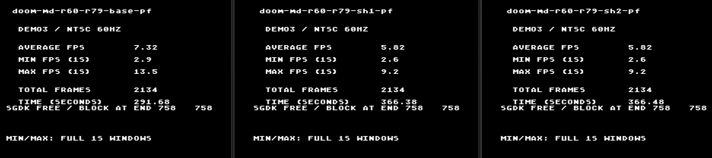

# MD-DOOM — projeto de melhoria de desempenho da R79 base

Documento para análise técnica independente em paralelo. Data de preparação: 27/10/2026. Autor da proposta: ChatGPT/Codex; decisões de produto e medições de aceitação: Daniel Santiago.

## Pedido ao agente revisor

Analise o jogo atual e esta proposta, confronte as hipóteses com os fontes e com o ELF, identifique os melhores próximos experimentos e devolva uma revisão fundamentada. Pode discordar das sugestões. O resultado desejado é uma sequência curta de mudanças com potencial real e equivalência verificável, não uma lista genérica de otimizações para C.

Escopo desta análise: desempenho do jogo atual. Save/load, novas fontes e novas técnicas de shadow serão trabalhos separados. Não existe uma nova otimização R80 implementada neste pacote.

## 1. Referência imutável e resultados disponíveis

- Repositório: https://github.com/bollux78/MD-DOOM64KB
- Commit do código R79: `31807c0355298f35ec36ab0c42a847a2493d92e4`.
- Branch histórico: `exp-chatgpt-r79-shadow-20261027`.
- Configuração aceita: `r79-base-pf` / `r79-base-pl`, sem `DOOM_R79_SHADOW` no compilador.
- Build validado: https://github.com/bollux78/MD-DOOM64KB/actions/runs/40597005254
- Artefato CI original: `12776668748`, `doom-md-r79-shadow-6-roms`.
- Prioridades posteriores: https://github.com/bollux78/MD-DOOM64KB/blob/exp-chatgpt-r80-roadmap-20261027/docs/agent-handoffs/R80-PRIORIDADES-DESEMPENHO-SAVE-FONTES-SHADOW.md

O branch histórico também contém SH1/SH2. Elas NÃO são a base de otimização. Os flags e binários de controle incluídos em `control-build/` removem a ambiguidade.

### Medição completa enviada pelo usuário

DEMO3, NTSC 60 Hz, 2.134 quadros informados pela própria tela de benchmark:

| Variante | FPS médio | Mínimo em janela de 1 s | Máximo em janela de 1 s | Tempo total |
|---|---:|---:|---:|---:|
| R79 base | 7,32 | 2,9 | 13,5 | 291,68 s |
| SH1 | 5,82 | 2,6 | 9,2 | 366,38 s |
| SH2 | 5,82 | 2,6 | 9,2 | 366,48 s |



Origem: imagens e avaliação visual fornecidas pelo usuário nesta conversa. Não é uma nova medição do autor deste projeto. O ambiente exato de execução dessas capturas não está identificado aqui; não rotular esses números como medidos em hardware físico sem confirmação. As capturas disponíveis estão em `evidence/`.

SH1/SH2 perderam aproximadamente 20,5% dos FPS; o tempo aumentou aproximadamente 25,6%. O usuário considerou a diferença visual pequena e rejeitou o custo. A implementação acrescentava um pós-processamento de 798 blocos por quadro para comparar erros e remapear cores. Esse é um forte suspeito, não uma atribuição de ciclos demonstrada por perfil isolado. O shadow do menu permanece: ele atua no menu com render congelado e não é o experimento rejeitado.

### Limites do build de controle

| Item | PERF | PLAY |
|---|---:|---:|
| ROM | 2.883.584 bytes | 2.883.584 bytes |
| BSS | 57.896 bytes | 57.910 bytes |
| Folga até 57.920 | 24 bytes | 10 bytes |

ROM máxima: 4 MiB. Não elevar o limite de BSS para acomodar uma ideia. Há espaço de ROM que pode ser mais útil do que criar estado permanente em WRAM.

## 2. O que precisa permanecer igual

- Clock original do Mega Drive; nenhuma alteração de velocidade da CPU/emulador.
- Mesma resolução lógica, viewport, recorte, conteúdo de textura, quatro perfis de cores e parâmetros de benchmark.
- HUD original atual, margem de pedra em torno do rosto, menu rápido que congela o render, fundo de pedra, texto legível e restauração correta ao sair.
- Artes de abertura/intermissão e comportamento das telas estáticas.
- Música, efeitos, controles, simulação, RNG, colisões e avanço do DEMO3.
- H32/H40, mudanças de perfil, tintas de dano/bônus e retorno de menus/telas nativas.
- Equivalência dos samples do renderer; ganho por remover qualidade, entidades, áudio ou quadros apresentados não é aceito.

Se uma ideia exigir relaxar algum desses pontos, apresente-a separadamente como mudança de produto, fora desta rodada de otimização equivalente.

## 3. Entender o código que realmente roda

### Arquitetura relevante

O renderer lógico usa 76×44 samples. Pair-V organiza um framebuffer de 3.344 bytes em 22 linhas físicas, cada uma com 38 words do plano A e 38 do plano B. Cada word contém atributos/índice no byte alto e dois códigos de sample no byte baixo. A metade alta/baixa do byte representa samples verticais; a paridade de x escolhe o plano. B fica deslocado 4 pixels em relação a A.

Os 512 padrões de pares ficam preparados na VRAM; a apresentação copia mapas de tiles, não um framebuffer RGB convencional. O endereço de um byte de sample é definido em `src/r22_pixel4.h`:

```c
p + (y >> 1) * 152 + (x & 1) * 76 + (x >> 1) * 2 + 1
```

Isso orienta a proposta de offsets, mas não prova que uma LUT seja mais rápida no 68000. Precisamos conferir o assembly atual e o custo das leituras adicionais em ROM.

Os flags do controle já habilitam, entre outras técnicas: kernel de parede em ASM, Pair-V rápido, LUTs de colormap compostas, contexto de view R64A, COLPAIR R66, locais/invariantes de segloop R70A e multiplicação ASM R71. MOVEP para cache/mapa e agrupamento de dados de linha/lado também já estão habilitados. Não propor como novidade algo que já está ativo.

### Onde olhar primeiro

Referências abaixo são do snapshot `reference-prepared/`, que já recebeu os patches R72…R79:

| Código | Local de entrada aproximado | Questão |
|---|---|---|
| Endereçamento Pair-V | `src/r22_pixel4.h:14` | strides, paridade, extensão de 16/32 bits |
| Contexto por frame e LUT composta | `src/r22_video.inc:100–140` | o que já foi antecipado; quais fallbacks continuam necessários |
| Parede / prólogo | `src/r22_video.inc:745`, `R42_DrawPackedWall` | clipping repetido, seleção de LUT, fração, chamadas e spills |
| Flat | `src/r22_video.inc:923`, `R_DrawColumnFlat` | custo fixo por coluna e cálculo do destino |
| Kernel de parede | `src/r60_pair_wall.s` e `.h` | ABI, paridades, bytes preservados, laço quente |
| Resolução de coluna | `src/r_draw.c:2607`, `R_DrawSegTextureColumn` | lookup de patch, composição e tempo de vida de source |
| BSP/subsetor | `src/r_draw.c:3850`, `R_Subsector` | pressão de registradores e cola por segmento |
| Multiplicação já otimizada | `src/r_draw.c`, em torno da linha 701 | confirmar chamadas restantes a libgcc, não repetir R71-MUL |
| Publicação e DMA | `src/r22_video.inc:1242`, `R20_VBlankVideo` | ownership, quantidade de words e sincronismo |
| Espera de vídeo | `src/r22_video.inc:1318`, `R20_StopVideo` | CPU ocupada versus espera necessária pelo próximo vblank |
| Loop principal | `src/d_main.c:351`, `D_DoomLoop` | relação entre tics, render e mapa pendente |
| SRAM | `src/r22_blocklinks.*`, `src/r23_mapmem.c`, `src/r39c_movep.h` | acessos de campo, agrupamento e mapeamento do cartucho |

As linhas servem para navegação; confirme pelo nome da função. Muitas variantes coexistem sob `#if`. A fonte da verdade sobre a configuração é o arquivo de flags do controle e seu ELF.

## 4. Evidência histórica: pistas, não perfil atual

A revisão R71 encontrou, em uma A12 anterior à R79:

| Grupo histórico | Amostras aproximadas |
|---|---:|
| BSP + subsetor | 21,8% |
| Cola C das colunas de parede | 16,2% |
| Kernel ASM de parede | 12,4% |
| Setup de segmento/geometria | 10,3% |
| Lógica do jogo | 8,3% |
| Flats | 7,0% |
| Sprites/masked | 6,6% |

Esses grupos não são um orçamento atual nem devem ser somados com percentuais por função, que podem se sobrepor. A evidência e as ressalvas completas foram preservadas em `docs/agent-handoffs/R71-RESPOSTA-CLAUDIO-20261026.md` e `docs/review-r71/R71-PC-PROFILE-REPORTS-RAW.txt`.

No histórico, a amostragem HInt não funcionou; houve fallback para VInt, com viés de fase. Os endereços daquele ELF não identificam as funções do ELF R79. R71-MUL foi implementada depois; não tratar os antigos ~4% de `__mulsi3` como custo ainda intacto. Uma mudança de ROM pode alterar LTO, inlining e alocação de registradores.

Primeira tarefa do revisor: confirmar o assembly atual e obter um perfil limitado da R79, se houver ambiente. Se não houver, marcar a análise como estática e manter os percentuais como históricos.

## 5. Propostas para crítica e experimentação

### P0 — perfil e diagnóstico atual, antes de escolher o alvo

Conferir símbolos/flags, extrair disassembly dos principais caminhos e medir onde o tempo vai. Separar chamadas, prólogos/epílogos, acessos a stack, ROM/SRAM, multiplicações/divisões auxiliares e espera de vídeo. Não introduzir contadores pesados na ROM usada para medir ganho final.

Perguntas: o kernel continua perto de 12%? O prólogo ainda duplica clipping já feito no caller? Que chamadas a libgcc restaram? O custo de SRAM cresceu em relação ao perfil histórico? Há trabalho por frame fora do render que não deveria ser repetido?

### P1 — offsets em ROM para o destino do framebuffer

Experimento de baixo risco sem estado permanente: testar uma tabela de 22 offsets de linha (`row_base[k]=k*152`, 44 bytes em uint16_t), uma tabela de 76 offsets de coluna (`column_base[x]=(x&1)*76+(x>>1)*2+1`, 152 bytes), e só depois a combinação das duas.

Total máximo dessas duas LUTs: 196 bytes de dados em ROM. Para x=75,y=43, o maior offset é 3343. Duas coordenadas de y compartilham o mesmo byte e diferem pelo nibble; isso deve permanecer exato. Não mudar a organização do buffer.

Aplicar primeiro aos setups de parede/flat já recortados. Não transformar indiscriminadamente um helper público em leitura de tabela sem validar todos os seus callers. Comparar o assembly de controle e candidato: uma lookup a mais, cálculo do endereço da tabela ou spills podem superar o custo removido.

Validação mínima: enumeração das 76×44 coordenadas válidas; endereço e nibble corretos; preservação do byte de atributos e do sample vizinho; guards em volta do buffer. Testes de clipping continuam no caller. Esta proposta não tem ganho medido ou percentual garantido.

### P2 — caminho rápido de parede com contrato comprovado

Investigar uma entrada especializada apenas para a rota opaca cujas entradas já foram recortadas. O caminho genérico continua atendendo entradas excepcionais e outros callers. O alvo é a cola do kernel, não redesenhar sua matemática logo de início.

Provar antes de eliminar checks: x dentro da view e do buffer; limites y válidos; colormap composto realmente válido para perfil/paridade atuais; source com vida útil suficiente; count suportado. Preservar fallback quando o contrato não vale. Sky, masked e caminhos com um sample precisam de tratamento explícito.

A fração inicial usa y original e depois compensa o clipping. Não trocar a ordem das operações, o truncamento de 16 bits ou o wrap do acumulador ao mover cálculos. Um ganho que desloca uma linha de textura já é uma regressão.

No assembly, contar argumentos, chamadas, MOVEM, spills e recargas do contexto. Remover uma função em C não garante retirar o custo se LTO já a eliminava, nem garante que o corpo maior não aumente spills.

Validação: controle versus candidato com entradas válidas, cada pré-condição violada isoladamente, paridades, limites da viewport, count=0/1/2/44, clipping superior/inferior, perfis/tintas, sky/masked e framebuffer real. Testar as rotas que precisam cair no fallback, não apenas a rota otimizada.

### P3 — registradores e aritmética em BSP/setup

Auditar `R_Subsector` e os blocos de setup do segloop no ELF R79. Procurar cargas repetidas que ainda existam e derramamentos introduzidos por inlining. Locais e invariantes já estão ativos. `__mulsi3` só é alvo se a chamada restante estiver no caminho quente e houver prova dos intervalos/tipos envolvidos.

Sugestões condicionais: reduzir a duração de variáveis vivas; recomputar uma expressão muito barata se isso evitar spills mais caros; especializar produtos apenas quando o intervalo real justificar 16×32; testar separação/inlining de helpers como experimentos independentes. Não aplicar atributos globais de inlining ao renderer inteiro.

Validação: equivalência da aritmética com sinais e limites, sem depender de comportamento indefinido de C; demo e estado de jogo iguais. Usar os testes R70/R71 incluídos como referência de casos, adaptando ao código proposto.

### P4 — reduzir overhead de resolução de texturas, com cautela

`R_DrawSegTextureColumn` faz lookup e pode compor colunas. O histórico de hoists semelhantes teve perdas, embora em renderer anterior; foi preservado em `docs/r20g-results.md`. Não reativar flags rejeitadas como se fossem otimização confirmada.

Só avançar se o perfil atual apontar custo relevante e for possível antecipar metadados imutáveis por segmento sem aumentar WRAM. Distinguir ponteiro de metadado ROM de ponteiro de coluna composta sujeito a reutilização/evicção do cache. Um ponteiro que era válido na coluna anterior pode não continuar válido na próxima.

Revisor deve dizer se há uma transformação nova concreta ou se este item deve continuar adiado. Exigir ganho líquido após considerar argumentos adicionais e pressão de registradores.

### P5 — SRAM: custo de transações e campos

MOVEP e agrupamentos R27 já fazem parte do controle. Investigar acessos repetidos que tenham sobrado, mantendo o formato e a validade das ligações de objetos/setores. Pequenos snapshots locais podem ser candidatos se substituírem várias transações e não criarem cache permanente.

Antes de alargar uma janela SRAM, provar segurança de ROM acima de 2 MiB, áudio/Z80, interrupções e wrappers de acesso. Não manter SRAM ligada por um frame inteiro por conveniência. Não transferir estruturas quentes inteiras para WRAM: há somente 10 bytes de folga no PLAY.

Validação: movimento, colisões, portas, plataformas, objetos removidos/religados, mapas de maior ocupação e música. Testes host não substituem cartucho real para o comportamento de mapeamento.

### P6 — sincronismo, espera e DMA

A espera ocupada não é automaticamente tempo recuperável. Determinar se há trabalho útil bloqueado, espera inevitável pelo vblank ou quantização que mascara ganhos pequenos. Preservar ownership do mapa pendente: o buffer não pode ser alterado enquanto o VBlank ainda o lê.

Possíveis perguntas: algum wait é redundante em uma rota provada? A quantidade de DMA já reflete o crop? Há recarga de padrões/paleta desnecessária durante gameplay estável? Se não houver evidência, não alterar o protocolo.

Validação: quadros realmente apresentados, tics, vblanks, áudio, transições, retorno do menu e H32/H40. Não aceitar um FPS maior que apenas deixou de esperar a apresentação correta.

### P7 — kernel ASM de parede, depois dos custos de setup

Se o novo perfil justificar, revisar o laço R60. Tentar preservar sua interface e testar apenas uma transformação por vez. Casos curtos, alinhamento/paridade e preservação dos samples vizinhos são tão importantes quanto a iteração longa. Não trocar um laço pequeno e correto por unrolling grande sem evidência de ganho líquido.

Não há promessa de ganho neste item. Como ilustração de limite teórico, melhorar em 20% uma região que represente 12% do tempo economizaria cerca de 2,4% do tempo total antes dos efeitos secundários — não 20% do jogo. As participações reais precisam vir da R79.

## 6. Ordem sugerida e regras de aceitação

1. P0: perfil atual + disassembly, com símbolos do ELF incluído.
2. P1 linha-only e P1 coluna-only em candidatos separados.
3. P2, se as pré-condições puderem ser demonstradas.
4. P3 conforme o perfil; P4/P5/P6/P7 somente com justificativa concreta.
5. Combinar apenas mudanças que ganharam isoladamente; medir novamente a combinação.

Critérios obrigatórios:

- Controle de mesmo código/flags e mesmas condições; build sem instrumentação para o resultado final.
- Mesmos samples/estado, guards intactos, sem overflow/UB novo, BSS ≤57.920 e ROM ≤4 MiB.
- Comparar frames por tic correspondente; excluir apenas regiões de texto/FPS explicitamente justificadas. Não esconder diferenças de mundo atrás de máscaras amplas.
- Diferença no framebuffer de samples não cobre tudo: mudanças em CRAM, padrões e DMA precisam de checagem adicional quando tocadas.
- Smoke de 800 frames prova inicialização, não equivalência completa nem ganho. Captura parcial demonstra somente o prefixo capturado.
- Benchmark de aceitação: DEMO3 completo, mesmos parâmetros e ambiente, preferencialmente repetições alternadas controle/candidato. Relatar tempo total e FPS; diferenças de arredondamento não contam como avanço seguro.
- Automação BlastEm limitada a 10.000 frames por execução; os wrappers deste pacote usam 8.000. Não contornar o limite com múltiplos processos em sequência para alegar teste completo. Há comentários históricos em ferramentas dizendo que um limite foi suspenso; isso não muda a restrição desta revisão. O usuário já realizou o benchmark completo de referência.
- Implementar candidatos em branch próprio derivado deste projeto, com testes e relatório. O workflow R80 é manual, seleciona somente controle ou candidato e mantém os limites de memória e smoke. Preservar a R79 base e respeitar o limite de 10.000 frames automatizados por execução.

## 7. Entrega solicitada ao outro agente

Enviar um Markdown com:

1. Diagnóstico do build atual e quais ferramentas/dados realmente foram usados.
2. Parecer sobre P1…P7: apoiar, modificar ou rejeitar, com função/bloco/assembly e motivo.
3. Até três experimentos prioritários, custo de ROM/WRAM, pré-condições e testes necessários.
4. Alternativas que o autor desta proposta não considerou, se houver.
5. Riscos de regressão e casos específicos que precisam entrar no difftest.
6. Estimativa de ganho apenas quando houver base para ela, claramente identificada como hipótese ou medida.
7. Implementação pequena e reversível no hook R80, nome de flag quando necessário, instruções de reprodução e resultados; se não foi executada, escrever isso explicitamente.

Não é necessário concordar com a ordem proposta. Prefiro que uma hipótese ruim seja descartada antes de gerar outra matriz de ROMs.
